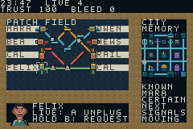

# LINE NOISE!

`LINE NOISE!` is a playable Game Boy Advance vertical slice about operating Port
Meridian's old manual telephone exchange. Correct patches keep calls moving;
live cord crossings decide which facts spill into other conversations, who acts
on them, and what the city remembers at dawn.



## Play

The current ROM is `192,920` bytes with SHA-256:

```text
ca365eb66dd22f720063fc3b58be07ba6e07e2b52eea0cea3592850dc2420f42
```

Build and launch it on this Mac:

```sh
DEVKITPRO=/opt/devkitpro DEVKITARM=/opt/devkitpro/devkitARM make -C game
open game/line-noise.gba
```

The cartridge header is `LINE NOISE! / LNSE / 00`. The title screen visibly
includes the requested exclamation point.

## What ships

- One authored eight-minute Final Week shift: `Platform Three`.
- Four calls, five concrete facts, one bridge field, and one ground clamp.
- Timed one-way crosstalk with over/under order and wrapped packet phases.
- Persistent City Memory, source/confidence tracking, and authored callbacks.
- Four objectives, four report dimensions, four epilogues, and playback.
- Operator School, untimed Open Lines, high contrast, and reduced flash.
- Eight embedded Direct Sound effects using Timer 0 and DMA 1.
- An artifact-first responsive showcase under `site/`.

## Verify

```sh
DEVKITPRO=/opt/devkitpro DEVKITARM=/opt/devkitpro/devkitARM make -C game verify size
python3 -m unittest discover -s game/tests -p 'test_*.py' -v
python3 tools/run_mgba_smoke.py
python3 tools/validate_assets_isolated.py
```

The current release passes 22 host/verifier tests, a frame-exact mGBA traversal
with ten unique decoded native captures, and all 956 isolated source-asset
checks. Details and reproducible commands are in [VALIDATION.md](VALIDATION.md).

## Showcase

The live showcase is
[line-noise.uppercut-labs.workers.dev](https://line-noise.uppercut-labs.workers.dev).

```sh
cd site
npm ci
npm test
npm run dev
```

The local preview runs at `http://localhost:3000`. Its ROM download is copied
from the validated game build and is intentionally ignored by Git as a generated
artifact.

## Repository map

- `game/`: libgba runtime, content, audio, build, tests, and native evidence.
- `line-noise-gba-asset-pack/`: compiled runtime asset sources used by the game.
- `tools/`: ROM/ELF verification, mGBA automation, and isolated asset checks.
- `site/`: vinext showcase source and server-rendered validation.

The public release contains only the runtime assets needed to compile and play
the game; local concept-pack working material is intentionally excluded.

## Scope and clearance

This is the complete playable vertical slice supported by the authored pack,
not the concept's proposed ten-shift campaign. The supplied pack describes the
title as a working title and includes no trademark or legal-clearance opinion.
